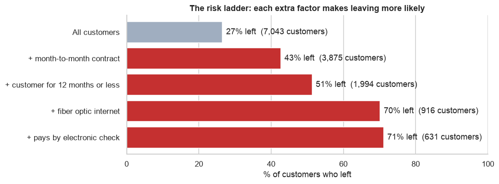
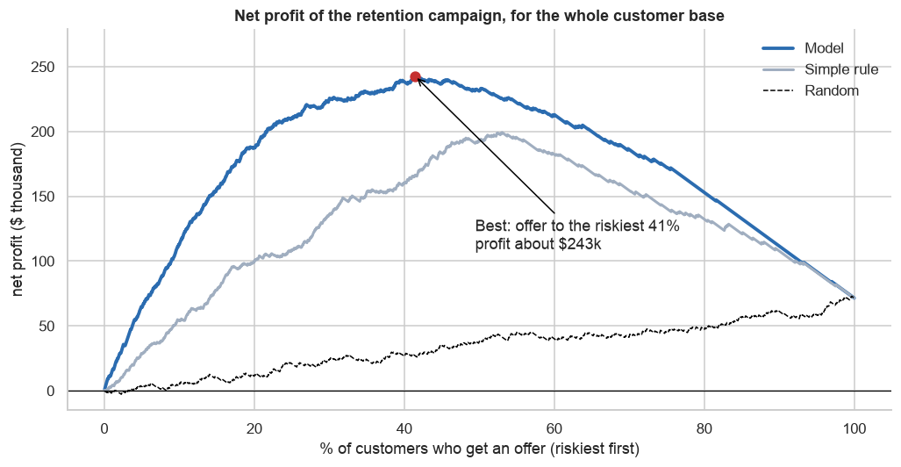

# Which Customers Will Leave, and How Much Can We Save?

A customer churn analysis for a telecom company: who leaves, why, and how to spend a retention budget for the biggest return.

**Tools:** Python (pandas, scikit-learn), Matplotlib

**[View the full analysis notebook](telco_churn_retention.ipynb)**

## Key findings

Based on **7,043 customers**, of whom **1,869 (26.5%) left** in one month.

- **Churn is expensive:** leavers took **30.5% of monthly revenue** with them, about **$1.67 million a year**, because they paid more on average ($74 against $61 a month).
- **Commitment is the biggest factor:** 43% of month-to-month customers left, against only 3% on two-year contracts. **53% of customers in their first 6 months** left.
- **The riskiest group:** new month-to-month customers with fiber internet leave at **70%**, almost 3 times the average.
- **A simple model finds them:** calling the 20% of customers with the highest risk scores reaches **50% of all leavers**, against 20% for random calls.
- **Targeting pays:** a retention offer for the riskiest **41%** of customers would earn about **$243,000** net, against $71,000 for offering it to everyone.





## Recommendations

1. **Run a targeted retention campaign** for the riskiest 40% of customers.
2. **Focus on the first year** with onboarding and check-in calls.
3. **Encourage longer contracts** with a discount for switching from month-to-month.
4. **Investigate the fiber optic service**, whose customers leave twice as often as DSL customers.
5. **Promote automatic payments and tech support.**
6. **Test the offer on a small group first** to measure its real success rate.

## Business questions

1. How many customers leave, and what does it cost?
2. Which kinds of customers leave most often?
3. What does the riskiest customer look like?
4. Can a model predict who will leave?
5. How many customers should get an offer, and how much would it save?

## Method

1. **Clean:** fix 11 blank `TotalCharges` values (all new customers with 0 months of tenure).
2. **Explore:** churn rate by contract, tenure, internet type, payment method, support and age, plus a "risk ladder" combining the top factors.
3. **Model:** logistic regression, trained on 75% of customers and tested on the other 25%, compared with a simple rule and random calls.
4. **Money:** turn the risk scores into a campaign plan, with editable assumptions ($60 offer cost, 30% success rate, 12 months of extra revenue) and a check of what happens if the offer works better or worse.

## Limitations

- IBM's fictional sample data, so the numbers show the method, not a real company's results.
- One snapshot in time, with no information on why each customer left.
- The offer's cost and success rate are assumptions and should be tested with a small trial first.
- The patterns show correlation, not cause.

## Run it yourself

1. Download `WA_Fn-UseC_-Telco-Customer-Churn.csv` from [Kaggle: Telco Customer Churn](https://www.kaggle.com/datasets/blastchar/telco-customer-churn) and put it in a `data/` folder.
2. Install the packages:

   ```bash
   pip install -r requirements.txt
   ```

3. Open `telco_churn_retention.ipynb` and run all cells. Change `OFFER_COST`, `SUCCESS_RATE` and `MONTHS_KEPT` in section 8 to test other assumptions.

## Author

**Lilit Poghosyan**
