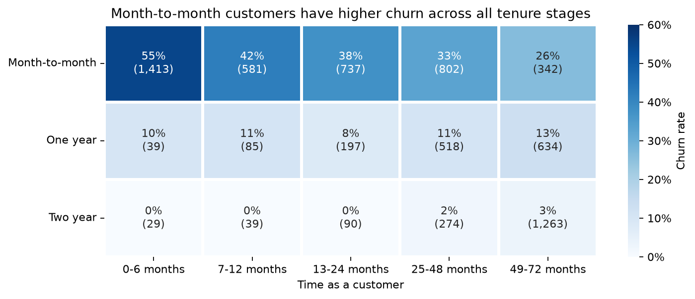
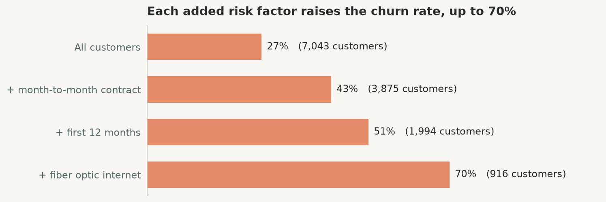
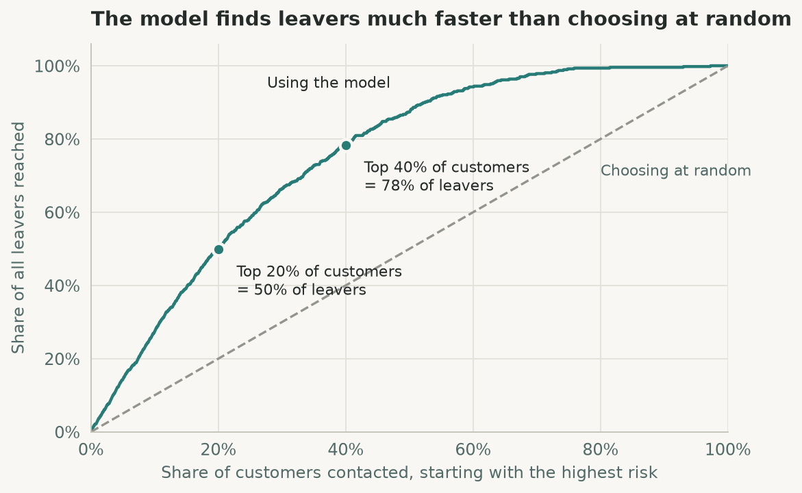
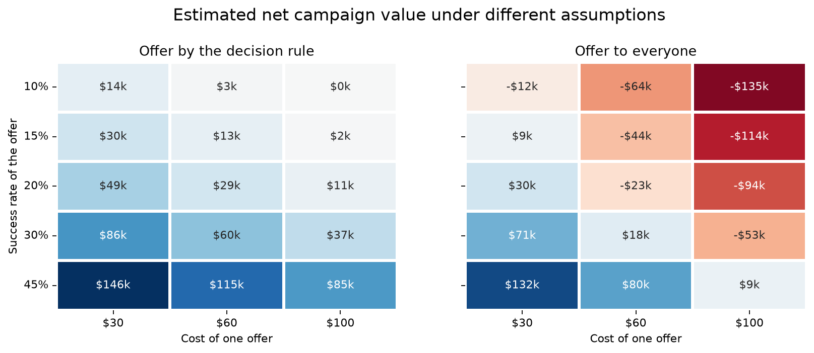

# Telco Customer Churn Analysis

**Who is leaving, what it costs and who should get a retention offer.**

An end-to-end data analysis project in Python: data cleaning, exploratory data analysis (EDA), a churn-risk model and a retention campaign plan with its expected profit.

**Tools:** Python, pandas, NumPy, Matplotlib, seaborn, SciPy, scikit-learn, Jupyter Notebook


## The business problem

A telecom company earns money only for as long as a customer keeps paying each month. Many customers are cancelling ("churning"), but the company does not know which ones or why. The retention team has a limited budget, so it cannot call every customer or give everyone a discount.

This project answers four questions:

1. How many customers leave and how much revenue goes with them?
2. Which kinds of customers leave most often?
3. Can we tell in advance which customers are at risk?
4. Who should get a retention offer and is it worth the money?

**Who it is for:** the retention and marketing team (who to contact), product managers (what to fix) and finance (what it is worth).

## The dataset

[Telco Customer Churn](https://www.kaggle.com/datasets/blastchar/telco-customer-churn), a sample dataset published by IBM. The company is fictional.

- **7,043 customers**, one row each, 21 columns, a single snapshot in time
- **Demographics:** gender, senior citizen, partner, dependents
- **Account:** tenure (months as a customer), contract type, paperless billing, payment method, monthly and total charges
- **Services:** phone, internet type and add-ons such as online security, tech support and streaming
- **Target:** `Churn`, whether the customer left in the last month

### Data cleaning

| Check | Result |
|---|---|
| Duplicate rows or customer IDs | None |
| Missing values | 11 blank `TotalCharges`, all brand-new customers (tenure = 0), set to 0 |
| Wrong data types | `TotalCharges` converted from text to number |
| Inconsistent labels | `SeniorCitizen` changed from 0 / 1 to No / Yes |
| Rows removed | None, all 7,043 customers are kept |

## Key findings

| | Finding |
|---|---|
| **Churn is expensive** | 1,869 customers (26.5%) left. They accounted for 30.5% of monthly charges, about **$139,000 a month**, because leavers paid more on average ($74 against $61). Annualised over 12 months that is about **$1.67 million**, an estimate of the revenue associated with churned customers, not a confirmed financial loss. |
| **Commitment matters most** | 43% of month-to-month customers left, against 11% on one-year and 3% on two-year contracts. Month-to-month customers are 55% of the base but **89% of all leavers**, and they leave more often at every tenure stage. |
| **The first months are critical** | 53% of customers in their first 6 months left, against 10% of those with more than 4 years. Leavers had a median tenure of 10 months, against 38 for those who stayed. |
| **Other warning signs** | Fiber optic internet (42% churn against 19% for DSL), payment by electronic check (45%), no tech support or online security (about 42% against 15%) and senior citizens (42% against 24%). |
| **Cheaper plans churn less** | Customers paying $18 to $25 a month left at 9%, against 26.5% overall. |
| **The riskiest group** | New, month-to-month customers with fiber optic internet leave at **70%**. They are 13% of customers and 34% of leavers. |
| **Almost no association** | Gender and phone service show almost no association with churn in this dataset. |





## The solution

### 1. A risk score for every customer

A logistic regression model scores each customer's chance of leaving. It was trained on 75% of customers and tested on the other 25% that it had never seen. It uses all customer details except `customerID` and `TotalCharges` (which largely repeats tenure, correlation 0.83).

- **AUC 0.845** on the test set, close to the 5-fold cross-validation score (0.843)
- A random forest was tested and scored the same (0.843), so the simpler, explainable model was kept
- With the default 50% cut-off: accuracy 80.1% (always predicting "stays" would score 73.5%), precision 64.7%, recall 55.0%
- Contacting the **top 20%** of customers by risk reaches **50% of all leavers**, 2.5 times better than choosing at random. The top 40% reaches 78%
- The strongest factors raising risk are fiber optic internet, a month-to-month contract and paperless billing. No internet service, a two-year contract and long tenure lower it most



### 2. A decision rule for the retention offer

Send the offer only when it is expected to earn more than it costs:

```
risk score × success rate × monthly bill × months kept  >  offer cost
```

On the 1,761 test customers, assuming a $60 offer that keeps 30% of would-be leavers for 12 more months:

| Plan | Customers contacted | Leavers reached | Campaign cost | Net profit |
|---|---|---|---|---|
| Offer to everyone | 1,761 (100%) | 100% | $105,660 | $17,875 |
| Offer to the top 20% by risk | 353 (20%) | 50% | $21,180 | $47,092 |
| **Offer by the decision rule** | **704 (40%)** | **75%** | **$42,240** | **$60,221** |

The decision rule earns about 3.4 times the profit of offering to everyone, at 40% of the cost. These figures show how the targeting strategy performs under the stated assumptions and are not a forecast of actual campaign results.

### 3. Three risk tiers

| Tier | Share who really left | Suggested action |
|---|---|---|
| High (over 50%) | 65% | Priority: personal call with the retention offer |
| Medium (20-50%) | 32% | Low-cost contact: check-in email, contract upgrade offer |
| Low (under 20%) | 7% | No offer. Keep service quality high |

### 4. A check of the assumptions

Across 15 combinations of offer cost ($30, $60, $100) and success rate (10% to 45%), **the decision rule never loses money**. Offering to everyone loses money in 8 of them.



## Recommendations

1. **Use churn risk scores to prioritise retention offers.** Start with the High-risk tier and monitor whether targeted offers improve retention.
2. **Test retention offers before a wider rollout.** Run an A/B test to measure the actual success rate and cost per retained customer.
3. **Improve the first 6 to 12 months** with welcome calls, setup assistance and follow-ups after the first bills.
4. **Encourage month-to-month customers to consider longer contracts.** Test incentives for switching to one-year contracts and measure the impact on retention.
5. **Investigate why fiber optic customers leave more often**: pricing, service reliability, complaints and competitor offers.
6. **Test introductory offers for tech support and online security**, comparing uptake and churn against a control group.
7. **Encourage automatic payment methods.** Test whether incentives for switching from electronic check improve retention.

Recommendations 3 to 7 are based on observed associations in the dataset. Further testing is needed to determine whether these actions actually reduce churn.

## What the notebook covers

| Section | Contents |
|---|---|
| Executive summary | The key findings in five bullet points |
| 1. The business problem | Context, questions, audience, what success looks like |
| 2. The dataset | Source and data dictionary |
| 3. Setup and loading | Libraries, chart style, first look at the data |
| 4. Data quality and cleaning | Data types, duplicates, the blank `TotalCharges` rows, category labels |
| 5. Exploratory data analysis | Target, numeric columns, churn rate by group and by tenure, correlation, ranking of factors (Cramér's V) |
| 6. Deep dive | Revenue associated with churn, contract × tenure, the riskiest segment |
| 7. Solution, part 1 | Train/test split, model comparison with cross-validation, test results, reach, model factors |
| 8. Solution, part 2 | Decision rule, campaign profit, risk tiers, sensitivity check, target list, summary of key numbers |
| 9. Recommendations | Seven actions for retention and further testing |
| 10. Limitations and next steps | What the analysis cannot show and what to do next |

Every chart is followed by a short insight in plain words.

## Project files

```
Churn Analysis/
├── Telco Customer Churn Analysis.ipynb   # the full analysis
├── README.md
├── figures/                              # the 13 charts as PNG files
└── outputs/
    ├── retention_target_list.csv         # ranked customer list for the retention team
    ├── campaign_plans.csv                # the three campaign plans compared
    ├── profit_sensitivity.csv            # profit under 15 sets of assumptions
    └── churn_rate_by_segment.csv         # churn rate for every customer group
```


## Limitations

- **Sample data.** IBM's fictional dataset, so the numbers show the method, not a real company's results.
- **One snapshot.** No history of how customers behaved before leaving and no information on why they left.
- **Assumed campaign numbers.** The offer's cost ($60), success rate (30%) and duration (12 months) are assumptions.
- **Correlation, not cause.** The analysis cannot prove that changing a factor would make a customer stay.
- **Who will leave is not who can be saved.** The model predicts who is likely to leave, not who will change their mind because of an offer.
- **Profit is measured on the test set.** The dollar figures are for 1,761 customers (a quarter of the base) and are an estimate, not a forecast.

## Next steps

1. Run an A/B test of the retention offer to measure the real success rate.
2. Add data on complaints, support calls and usage, which usually signal churn early.
3. Collect several months of history to see how risk changes over time.
4. Run an exit survey to learn the reasons behind fiber optic churn.
